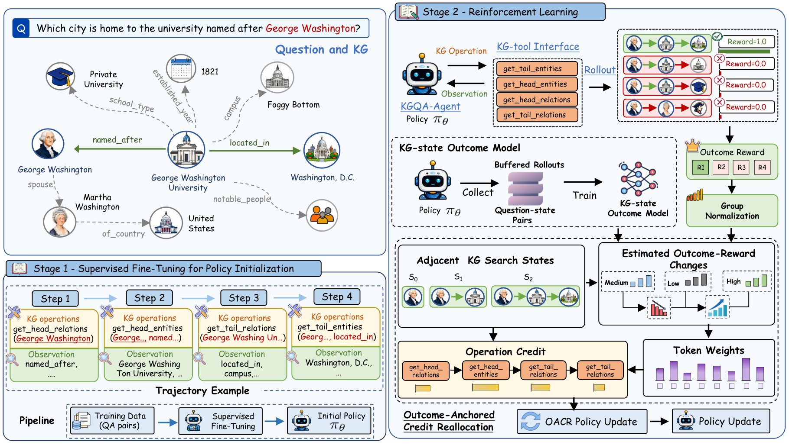

# Outcome-Anchored Credit Reallocation for Agentic Knowledge Graph Question Answering

Anonymous code for **OACR**.



[Figure 3 (PDF)](assets/Figure3.pdf)

## Installation

Linux, Python 3.10+, and PyTorch 2.8.0. Run commands from the repository root.

```bash
python -m venv .venv
source .venv/bin/activate
python -m pip install -e .
```

## Knowledge Graph and Data

Set up Freebase following [freebase/README.md](freebase/README.md), then start the KG service:

```bash
python scripts/serve_kg.py --config configs/freebase.yaml
```

Convert a benchmark into the format described in [data/README.md](data/README.md):

```bash
python scripts/stage_3_rl/prepare_rl_questions.py \
  --input data/raw/cwq_train.json --output data/processed/rl/train.jsonl --format cwq
```

Use `--format webqsp` or `--format grailqa` for the other benchmarks. Set dataset and model paths in [configs/](configs/).

## Training

Build trajectories and train the SFT policy:

```bash
python scripts/stage_2_sft/prepare_gold_paths.py --config configs/sft.yaml
python scripts/stage_2_sft/build_sft_trajectories.py --config configs/sft.yaml
accelerate launch scripts/stage_2_sft/train_sft_policy.py --config configs/sft.yaml
```

Train an outcome-only GRPO policy and collect the initial state-model buffer:

```bash
accelerate launch scripts/stage_3_rl/train_oacr_policy.py --config configs/rl.yaml --outcome-only
python scripts/stage_1_state_model/collect_buffered_rollouts.py --config configs/state_model.yaml
```

Prepare question-state targets and train the state model:

```bash
python scripts/stage_1_state_model/prepare_question_state_data.py --config configs/state_model.yaml
python scripts/stage_1_state_model/train_kg_state_outcome_model.py --config configs/state_model.yaml
```

Train OACR from the SFT policy:

```bash
accelerate launch scripts/stage_3_rl/train_oacr_policy.py --config configs/rl.yaml
```

The RL configuration uses 32 questions per batch, four rollouts per question, and mini-batches of 16 questions. The state model uses `BAAI/bge-large-en-v1.5`, with 16 initial epochs and one refresh epoch every 10 RL iterations on the most recent 8,192 rollouts. It stays fixed during each policy update and is excluded from inference.

Policy checkpoints are saved under `checkpoints/oacr_sft/`, `checkpoints/oacr_grpo/`, and `checkpoints/oacr_rl/`. Updated state models and training metrics are saved with the OACR run. For another run, set a new `output_dir`.

## Evaluation

Prepare test questions using the same conversion script, then evaluate a policy checkpoint:

```bash
python scripts/evaluate.py --config configs/evaluation.yaml \
  --model checkpoints/oacr_rl/epoch_1 \
  --questions data/processed/rl/test.jsonl --output results/predictions.jsonl
```

The evaluator writes rollout records and a summary containing F1, Hit@1, LLM calls, generated tokens, and latency. It uses only the policy and the KG service.

## Code

- [src/rl/](src/rl/): rollout sampling, outcome-anchored token weights, and policy updates.
- [src/state_model/](src/state_model/): canonical state targets, bounded rollout buffer, and state-model fitting.
- [src/sft/](src/sft/): gold-path trajectories and policy-token masking.
- [src/kg/](src/kg/): Freebase and local KG interfaces.
